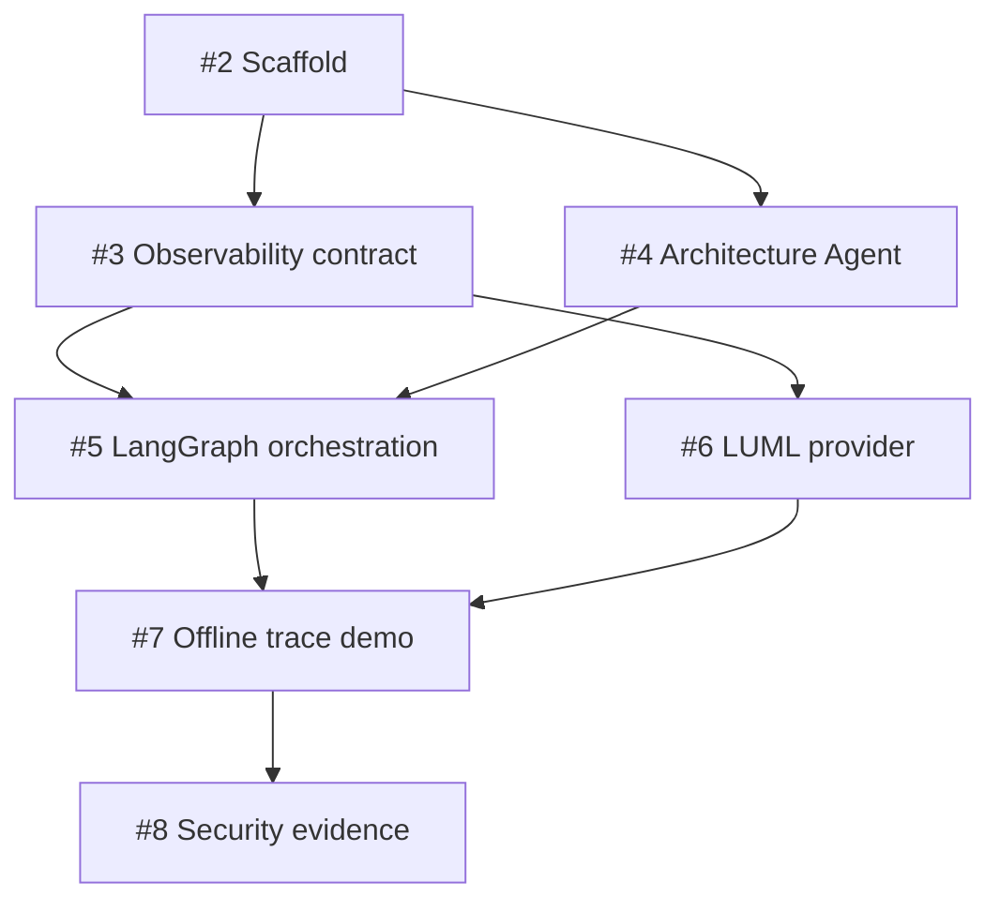

# AI-Native Secure Software Factory: Project Roadmap

> [!NOTE]
> This is the repository's issue-based execution plan. A GitHub Projects board can use these issues and existing priority/status labels as its initial backlog.

## Objective

Build an executable AI-native secure software factory, using the existing LangGraph and LUML bootstrap as the first agent-execution capability. Turn instrumented AI-agent activity into portable, reviewable security evidence aligned with the Continuous Delivery Foundation's [AI Security](https://cybersecurity.cd.foundation/docs/ai/) and [Cyber Resilience Act (CRA)](https://cybersecurity.cd.foundation/docs/cra/) guide chapters.

**Scope discipline:** establish a reproducible *local* demo and a portable evidence contract before introducing FRSCA/Tekton, Sigstore, a policy engine, or cloud infrastructure. Evidence capture is not the same as authorization enforcement or regulatory compliance.

## Prioritized backlog

Priority is about importance. **Execution order is constrained by dependencies**, so a high-priority blocked issue is not ready to start.

| Execution wave | Issue | Priority | State | Dependency | Deliverable |
| --- | --- | --- | --- | --- | --- |
| 0 | [#1 Bootstrap LangGraph + LUML](../../issues/1) | P0, epic | Tracking | #2–#7 | Demonstrable traced agent run |
| 1 | [#2 Scaffold Python project](../../issues/2) | **P0** | **Ready now** | None | Reliable `uv`, `ruff`, and `pytest` foundation |
| 2A | [#3 ObservabilityProvider + redaction](../../issues/3) | **P0** | Blocked | #2 | Backend-neutral telemetry contract |
| 2B | [#4 Architecture Agent](../../issues/4) | **P0** | Blocked | #2 | Testable LLM-injected agent |
| 3A | [#5 LangGraph orchestration](../../issues/5) | P1 | Blocked | #3, #4 | Agent run lifecycle + recorded actions |
| 3B | [#6 LUML provider](../../issues/6) | P1 | Blocked | #3 | Local trace persistence |
| 4 | [#7 Offline example + documentation](../../issues/7) | P1 | Blocked | #5, #6 | Reproducible end-to-end trace |
| 5 | [#8 Security-evidence contract](../../issues/8) | P1 | Blocked | #7; reuse #3 types | Portable evidence JSON and CDF guidance mapping |

**Parallel execution:** #3 and #4 can start in parallel after #2; #5 and #6 can proceed in parallel once their respective prerequisites are complete.

## Delivery milestones

### M1: Instrumented architecture agent
**Issues:** #2–#7 (tracked by epic #1).

- An Architecture Agent runs locally and returns a structured result.
- Run/node/LLM telemetry is recorded through the vendor-neutral interface and local LUML backend.
- An offline demo and tests are reproducible with no API keys or cloud account.

### M2: Exportable AI-agent security evidence
**Issue:** #8.

- A versioned schema captures actor/run identity, action summaries, outcome, Git revision references, and policy decision references when available.
- Evidence correlates with the LUML trace without leaking credentials, secrets, or raw prompts.
- Tests validate both successful and failed runs.
- Document the mapping from schema fields to the CDF AI Security and CRA guide chapters; distinguish **implemented**, **optional**, and **future** controls.

### M3: Secure factory integration (proposed, not yet ticketed)
After M2 is proven, discuss and create scoped upstream integration tickets for FRSCA/Tekton provenance, Sigstore/in-toto attestations, policy evaluation, and evidence verification. Avoid claiming CRA compliance solely from emitting an evidence record.

## Dependencies

## Issue labels and workflow

- `priority: P0`: critical foundation to start first; `priority: P1`: next implementation milestone.
- `status: ready`: unblocked and actionable.
- `status: blocked`: waiting for the prerequisites named in the issue.
- `type: epic`: coordination/tracking issue, not a separate implementation task.

**Operating rules:** move an issue from `status: blocked` to `status: ready` only after its prerequisites close; remove the old status label; mark in-progress work explicitly in the associated PR. The GitHub issue closed state represents Done.

## Suggested GitHub Projects configuration

- Project title: **AI-Native Secure Software Factory**
- Source repository: `lioramilbaum/software-factory`
- Board columns: **Ready**, **In Progress**, **Blocked**, **Done** (Project Status field).
- Views: **Board by Status**, **Table by Priority**, and **Roadmap by Milestone**.
- Add issues #1–#8; use issue labels as the starting priority and status assignments.

The first concrete action is **#2**. Close it before unlocking **#3** and **#4**.
